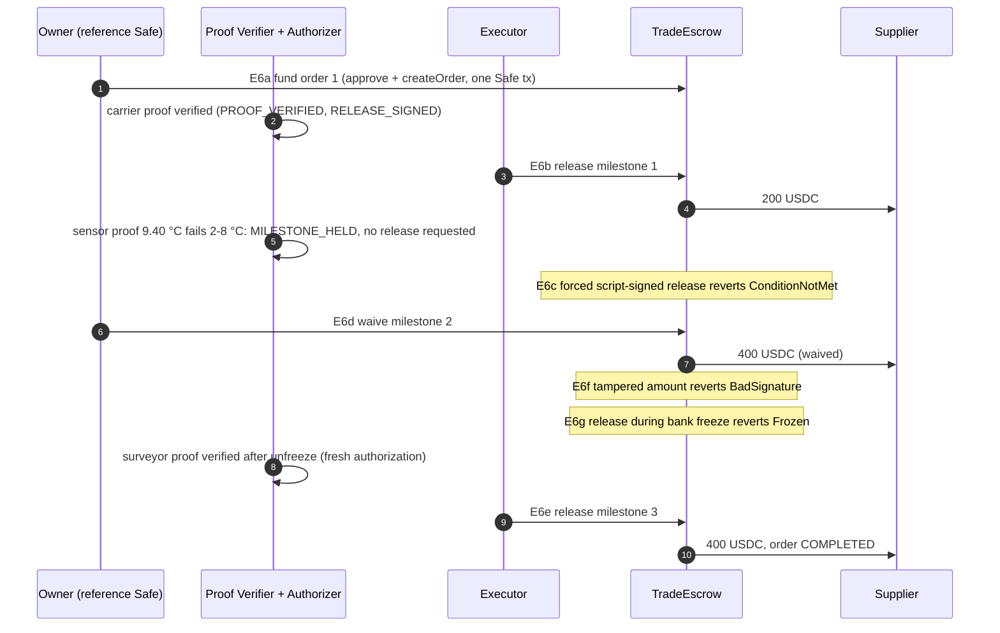

# Porthmos: Execution Evidence

| | |
|:-|:-|
| Purpose | Show, with evidence anyone can re-check, what Porthmos actually executed |
| Prepared | 20 October 2026 |
| Repository revision | `main` at `1c19881` (the audit changed documentation only; see [Technical Documentation §17.4](TECHNICAL_DOCUMENTATION.md#174-audit-scope-and-changes)) |
| Network | Base Sepolia testnet, chain ID 84532. **No mainnet transaction exists.** |
| Primary evidence file | [`deployments/evidence-84532.json`](../deployments/evidence-84532.json) |
| Re-verification | Read-only `cast` commands in [§2](#2-reproducibility-information) |
| Companion documents | [Technical Documentation](TECHNICAL_DOCUMENTATION.md) · [Security Self-Assessment Report](SECURITY_SELF_ASSESSMENT_REPORT.md) |

## Contents

1. [Executive evidence summary](#1-executive-evidence-summary)
2. [Reproducibility information](#2-reproducibility-information)
3. [Evidence classification](#3-evidence-classification)
4. [Contracts and blockchain references](#4-contracts-and-blockchain-references)
5. [End-to-end demonstration](#5-end-to-end-demonstration)
6. [Successful execution evidence](#6-successful-execution-evidence)
7. [Security rejection evidence](#7-security-rejection-evidence)
8. [Smart escrow and trade evidence](#8-smart-escrow-and-trade-evidence)
9. [Treasury and risk evidence](#9-treasury-and-risk-evidence)
10. [Test execution matrix](#10-test-execution-matrix)
11. [Evidence details](#11-evidence-details)
12. [Demo and replay guide](#12-demo-and-replay-guide)
13. [Evidence coverage and gaps](#13-evidence-coverage-and-gaps)
14. [Final evidence conclusion](#14-final-evidence-conclusion)

---

## 1. Executive evidence summary

**What is demonstrated.** On Base Sepolia, the Porthmos treasury agent deposited surplus cash into a vault with the owner's signed approval, pulled cash back when an invoice raised the required reserve, exited both vaults on a simulated depeg, and kept exits working while the bank froze the agent. TradeFlow escrowed a 1,000 test-USDC order and paid the supplier milestone by milestone on verified proofs, held a milestone whose temperature reading failed its condition, and let the owner waive it. Seven attack transactions (tampered signature, replay, moved price, deposit while frozen, forced release of a failing proof, tampered release, release while frozen) were mined and **reverted** with the expected custom errors.

**How the evidence was checked in this audit (20 Oct 2026).**

| Check | Result |
|:-|:-|
| Every one of the 33 transactions in the evidence file fetched from Base Sepolia | 33 found; status and sender match the record |
| Every reverted transaction re-executed at its parent block to decode the error | 7 of 7 decode to the recorded error |
| Deployed runtime bytecode compared with a local build of this revision | 7 Porthmos/mock contracts byte-identical (immutable slots masked); 4 canonical Safe contracts have code |
| Key events decoded (E1 `darHash`, E2/E3/E5 redeem amounts, E6 payees and amounts) | Match the evidence file |
| Contract, service and web test suites run locally | Pass, with two documented Windows-only issues (see [§10](#10-test-execution-matrix)) |

**What remains unverified.** The off-chain ledger rows (`ledgerRef`) and workflow states recorded in the evidence file come from the evidence run's local database, which is not in the repository; they are recorded claims, consistent with the transactions but not independently re-checkable. The hosted API was unreachable during this audit, so live UI behaviour was not re-observed. Live LLM behaviour was not re-verified; the recorded TradeFlow explanations came from the rule-based path (`"source": "rules"`).

**Where the evidence comes from.**

| Origin | Used for |
|:-|:-|
| Base Sepolia testnet | E1 to E6g, plus three live-app transactions of 18 Oct 2026 |
| Local automated tests (Foundry, pytest, Vitest) | Every security property, including scenarios not run on testnet |
| Local Anvil integration tests | End-to-end service paths, including an E6 dry run (its transactions succeed; on Windows the test fails at cleanup, see §10) |
| Web replay mode | Demonstration only; it sends nothing and is not evidence |

---

## 2. Reproducibility information

| Item | Value |
|:-|:-|
| Repository revision | `1c19881` (unchanged by the audit) |
| Chain | Base Sepolia, chain ID 84532; explorer `https://sepolia.basescan.org` |
| Treasury deployment | First block 48114516 (`DEPLOY_BLOCK` in `deploy/tencent/aegis.env.example`) |
| TradeEscrow deployment | Block 48204293 |
| Contract versions | `AegisModule`, `PolicyRegistry`, `TradeEscrow` as in `contracts/src/` at this revision; solc 0.8.28, optimizer 200, EVM `cancun` |
| Evidence recording | `service/scripts/evidence_84532.py`, runs on 14, 15 and 16 Oct 2026 (UTC; see `runs` in the evidence file) |
| Recording method | EIP-1559 transactions; attack transactions use a fixed 800,000 gas limit so that a reverting transaction is still mined and gets a hash. `contracts/script/Attack.s.sol` sends the same calls with legacy pricing and is used on Anvil |
| Service path for E6b/E6e | The script starts the five service processes locally against Base Sepolia with the operator keys (the hosted service was stopped to avoid nonce collisions): Proof Verifier → Authorizer `/sign-release` → Executor |
| Test frameworks | Foundry, pytest (+ Anvil), Vitest |
| Audit environment | Windows 11; Node 24.21; Python 3.12.10; uv 0.13.3; Foundry/Anvil 1.8.6-nightly `bbc7910` |

**Re-verify the on-chain evidence yourself** with Foundry's `cast` (read-only; any Base Sepolia RPC):

```bash
RPC=https://sepolia.base.org
# 1. Status and sender of a recorded transaction (every hash is in deployments/evidence-84532.json)
cast receipt 0x94b9690755fae93712ebb11dcf7a8d9c0095019493184e62b3e869943a68f68f status --rpc-url $RPC   # 1 = success
cast tx      0x94b9690755fae93712ebb11dcf7a8d9c0095019493184e62b3e869943a68f68f from   --rpc-url $RPC

# 2. Why an attack transaction reverted: replay it locally with a trace (needs an RPC that serves historical state)
cast run 0xdac68e9309a186f0cb6420ec21e3556b9b3efb64c2a3c483500079df595cc3d6 --rpc-url $RPC   # ends in BadSignature()

# 3. Deployed code against this repository
cd contracts && forge build
cast code 0xE6E9A49870C16F544F1adFB79003E4Df59055F2a --rpc-url $RPC   # PolicyRegistry on Base Sepolia
forge inspect PolicyRegistry deployedBytecode                          # identical output
```

`PolicyRegistry`, `MockUSDC` and `MockPriceFeed` have no immutables, so their bytecode compares directly. `AegisModule`, `TradeEscrow` and `MockVault` embed constructor arguments as immutables: compare with those byte ranges masked (positions in `deployedBytecode.immutableReferences` of the artifact in `contracts/out/`), and read the values back with `cast call <module> "registry()(address)"` and similar. The auditor ran these three checks for every transaction and contract with a small read-only script, which is not part of the repository.

---

## 3. Evidence classification

| Class | Meaning in this document |
|:-|:-|
| **Verified On-Chain Execution** | A Base Sepolia transaction whose receipt, sender, status and (for reverts) decoded error were re-checked in this audit |
| **Verified Automated Test** | A Foundry, pytest or Vitest test that passed in this audit |
| **Verified Local Integration Test** | A pytest integration test against a local Anvil chain that passed in this audit |
| **Recorded Testnet Record** | Off-chain data recorded during a testnet run (workflow states, ledger rows, request IDs), present in the evidence file but not independently re-checkable |
| **Recorded Replay** | The web app's replay mode, which re-displays recorded data and initiates nothing |
| **Simulation / Mock** | Behaviour of a mock (vaults, price feed, demo issuers) |
| **Unverified Claim** | Stated in project material, not verified here |

A reverted attack transaction is evidence that the contract **refused** the attempt. It is not a fund movement.

---

## 4. Contracts and blockchain references

Every address below holds code on Base Sepolia (checked 20 Oct 2026, latest block ~48,366,250). "Matches build" means the deployed runtime bytecode is byte-identical to `forge build` of this revision, with only immutable-variable slots masked; the immutables themselves were read back (`module.registry/usdc/priceFeed`, `escrow.registry/token`) and point at the addresses in this table.

| Contract | Address | Role | Check |
|:-|:-|:-|:-|
| AegisModule | [`0x786863E82d233eb60555dfeEFEe06068d8EcB318`](https://sepolia.basescan.org/address/0x786863E82d233eb60555dfeEFEe06068d8EcB318) | Agent execution path (Safe module) | Matches build |
| PolicyRegistry | [`0xE6E9A49870C16F544F1adFB79003E4Df59055F2a`](https://sepolia.basescan.org/address/0xE6E9A49870C16F544F1adFB79003E4Df59055F2a) | Per-Safe policy and roles | Matches build |
| TradeEscrow | [`0x009ca6F11b24fE0bAb9dE3EBb5dAb9e15f95ce76`](https://sepolia.basescan.org/address/0x009ca6F11b24fE0bAb9dE3EBb5dAb9e15f95ce76) | Milestone escrow | Matches build |
| MockUSDC | [`0x5C02E17b299d7BC9d5Af31128306a8E05e62BE63`](https://sepolia.basescan.org/address/0x5C02E17b299d7BC9d5Af31128306a8E05e62BE63) | Test asset (6 decimals) | Matches build |
| MockPriceFeed | [`0x3e9eB7a3B431a3df26135B54C7dcC61149F1fda6`](https://sepolia.basescan.org/address/0x3e9eB7a3B431a3df26135B54C7dcC61149F1fda6) | Test oracle (8 decimals) | Matches build |
| Vault A | [`0xBEf3507AF91BB2cac0c18fa65Bf68D45f1B44F3d`](https://sepolia.basescan.org/address/0xBEf3507AF91BB2cac0c18fa65Bf68D45f1B44F3d) | Mock ERC-4626 | Matches build |
| Vault B | [`0x7CAB5C889D4925834837dd5562Dd644Fd63d1D4a`](https://sepolia.basescan.org/address/0x7CAB5C889D4925834837dd5562Dd644Fd63d1D4a) | Mock ERC-4626 | Matches build |
| Reference Safe | [`0x2E1c2be3dD6BAa59344EdC6ee6A93D68e2295a0F`](https://sepolia.basescan.org/address/0x2E1c2be3dD6BAa59344EdC6ee6A93D68e2295a0F) | Treasury used for E1 to E6 | Safe proxy, code present |
| SafeL2 v1.4.1 | [`0x29fcB43b46531BcA003ddC8FCB67FFE91900C762`](https://sepolia.basescan.org/address/0x29fcB43b46531BcA003ddC8FCB67FFE91900C762) | Canonical singleton | Code present |
| SafeProxyFactory v1.4.1 | [`0x4e1DCf7AD4e460CfD30791CCC4F9c8a4f820ec67`](https://sepolia.basescan.org/address/0x4e1DCf7AD4e460CfD30791CCC4F9c8a4f820ec67) | Canonical factory | Code present |
| MultiSendCallOnly v1.4.1 | [`0x9641d764fc13c8B624c04430C7356C1C7C8102e2`](https://sepolia.basescan.org/address/0x9641d764fc13c8B624c04430C7356C1C7C8102e2) | Canonical batcher for order funding | Code present |

Whether the source is verified on BaseScan was not checked.

**Operator and actor addresses** (from `deployments/84532.json` and the evidence file):

| Role | Address |
|:-|:-|
| Reference owner | `0x01c38dfC1Eb6D925E5e302910E1C83CED96c1663` |
| Reference bank | `0x08FC2B2FfDec2d52B6Bc41f45d791Cf37933e594` |
| Authorizer | `0x7682b4855cc2a68D2c6b4594072ba504AE321d1d` |
| Exit key | `0x40C5E17C85b03C38faC331a94477D77F3b3e5839` |
| Executor | `0xfd299800e629Ab2D708fF399C79DbEd06569528D` |
| Keeper | `0x7d22e1c8D1B8B9FFe872F6312605f889cc73C8ed` |
| Deployer (mock admin) | `0x8Bc237EB07C7b88117837d2B57C9204A50CfD5cC` |
| Attacker (sends refused attacks) | `0xF325f85cf0C982c3F5b40F4AA127C03eBe2C7389` |
| E6 supplier | `0xF64f65B9AaCDCB3F0c619EAA94D631D79841a7Ab` |
| Demo issuers (carrier, sensor, surveyor) | `0x4A9Ec1f4…9c76`, `0xb7F84e62…4300`, `0x4b304413…6ee7` |

**Reference policy at deployment:** auto cap 1,000 USDC, daily cap 5,000 USDC, bank limit 3,000 USDC, reserve floor 4,500 USDC, max band width 0.02, max oracle age 180 s.

---

## 5. End-to-end demonstration

E1 is the clearest single trace of the whole pipeline. Every step below is backed by the evidence file (request `req_a4180fd1bf1441d8`) and the final transaction by the chain.

| Step | What happened | Evidence | Class |
|:-|:-|:-|:-|
| 1. Request | The owner asks for a deposit through the Copilot API | `requestId`, workflow `REQUEST_RECEIVED → INTENT_PARSED` | Recorded Testnet Record |
| 2. Analysis | State loaded, risk evaluated, plan options built, option selected | `STATE_LOADED → RISK_EVALUATED → PLAN_OPTIONS_BUILT → OPTION_SELECTED` | Recorded Testnet Record |
| 3. Policy | Validated, policy-checked, simulated; first deposit into Vault B so tier T3 | `PROPOSAL_VALIDATED → POLICY_CHECKED → SIMULATED`, `tier: 3` | Recorded Testnet Record |
| 4. Approval | Waits for the owner; the owner signs an EIP-712 `Approval` (max 2,000 USDC, policy version 11) | `AWAITING_APPROVAL → APPROVED`; ledger rows 2 to 4; `approval` object | Recorded Testnet Record |
| 5. Revalidation and signing | State reloaded and re-simulated; the Authorizer signs the DAR | `FINAL_REVALIDATION → DAR_SIGNED`; ledger row 5; `darHash 0x1953fb89…38c4` | Recorded Testnet Record |
| 6. Submission | The Executor submits `deposit` to `AegisModule` | Tx sender `0xfd29…528D` (Executor) | Verified On-Chain Execution |
| 7. Contract checks and execution | The module re-checks tier, signatures, oracle, caps and floor, then deposits 2,000 USDC into Vault B for 2,000 shares | Receipt status 1; `AegisExecuted(op 0, assets 2,000, shares 2,000, tier 3)`, `darHash` equals the recorded one | Verified On-Chain Execution |
| 8. Audit trail | `CONFIRMED`, then `EXPLAINED` | Ledger row 7 | Recorded Testnet Record |

Transaction: [0x94b96907…](https://sepolia.basescan.org/tx/0x94b9690755fae93712ebb11dcf7a8d9c0095019493184e62b3e869943a68f68f) (block 48114963, 14 Oct 2026 17:16:54 UTC).

The same pipeline is exercised end to end, on a local chain, by `tests/integration/test_anvil.py::test_t3_deposit_executes_on_chain` (Verified Local Integration Test).

---

## 6. Successful execution evidence

| ID | Operation | Tx | Block / time (UTC) | Decoded result |
|:-|:-|:-|:-|:-|
| E1 | T3 deposit, 2,000 USDC → Vault B, owner Approval | [0x94b96907…](https://sepolia.basescan.org/tx/0x94b9690755fae93712ebb11dcf7a8d9c0095019493184e62b3e869943a68f68f) | 48114963 / 14 Oct 17:16 | `AegisExecuted` DEPOSIT, tier 3 |
| E3a | Owner raises the reserve floor to 8,499.70 USDC | [0x0de6d291…](https://sepolia.basescan.org/tx/0x0de6d291f83eb68492ca697a1c109fc4690c45de4ed8b25a213f15859645fd93) | 48114969 / 14 Oct 17:17 | `PolicyChanged`; registry floor reads 8,499.70 today |
| E3b | Agent redeems 1,099.82 USDC from Vault B (T1) | [0xab44d6da…](https://sepolia.basescan.org/tx/0xab44d6dac64e4c33f52ef118dc032991cb9cc182ee9c4976e2269adafe227fce) | 48114990 / 14 Oct 17:17 | `AegisExecuted` REDEEM 1,099.82 |
| E2a/b | Exit key quarantines Vault A and Vault B | [0x7023601d…](https://sepolia.basescan.org/tx/0x7023601da934f3471bf0bca2f2ba1ddbc8b4dbedd5d923a27206be98b97044da), [0x4c312b16…](https://sepolia.basescan.org/tx/0x4c312b1649b19743acf61b60016ba43751d1a56d1b76acbf9dceeb565e0b7428) | 48115003-04 / 14 Oct 17:18 | `Quarantined`, `PolicyChanged` |
| E2c/d | Exit-key DARs redeem 500.00 (A) and 900.18 (B) to the Safe | [0x8f73300b…](https://sepolia.basescan.org/tx/0x8f73300bc28a76ee7a4ea74b601f98d8a4986039506ae6e80e7e6def570547a8), [0xef0405bb…](https://sepolia.basescan.org/tx/0xef0405bb86f711cb020d42b2c8e394fbf1c90b14c31e9291bfdb570e1e07a1be) | 48115005-07 / 14 Oct 17:18 | `AegisExecuted` REDEEM, tier 1 |
| E5b | Exit-key redeem of 250.00 from Vault A **while the bank freeze holds** | [0xdf111f38…](https://sepolia.basescan.org/tx/0xdf111f382bf5716d26347c6010344355188ae8abafe9bc50d7edf451c4728a66) | 48158300 / 15 Oct 17:21 | `AegisExecuted` REDEEM, tier 1 |
| E6a | Reference Safe funds order 1 (1,000 USDC, 200/400/400) via MultiSendCallOnly | [0x63a8622b…](https://sepolia.basescan.org/tx/0x63a8622b38aa631533900f5cea7b92699132b1d2e1e036bff2fc8f035c1a07f1) | 48205059 / 16 Oct 19:20 | `OrderCreated`; allowance after 0; committed 1,000 |
| E6b | Release of milestone 1: 200 USDC to the supplier | [0x86cbfd7e…](https://sepolia.basescan.org/tx/0x86cbfd7e450b18d54448d7b28c57c20d3ddbeb7308faa5e2eba392fa67402281) | 48205076 / 16 Oct 19:20 | `MilestoneReleased` index 0, 200, proof hash matches |
| E6d | Owner waives milestone 2: 400 USDC to the supplier | [0xb7a2a417…](https://sepolia.basescan.org/tx/0xb7a2a4178f7cbb6cb865244e6bc4a2832f94cbc8d926b848834ff432ef2a6160) | 48205089 / 16 Oct 19:21 | `MilestoneReleased` index 1, `waived = true` |
| E6e | Release of milestone 3: 400 USDC; order completed | [0xf4a27910…](https://sepolia.basescan.org/tx/0xf4a27910945cd6e6044bcd7973ee41e066c98762df15218802b70a60f1be1493) | 48205115 / 16 Oct 19:21 | `MilestoneReleased` index 2; `getOrder(1)` reads status COMPLETED, released 1,000 today |

**Live multi-tenant app, 18 Oct 2026** (not in the evidence file; referenced by the README screenshots; verified on-chain in this audit). Tenant Safe `0x9f0dA1539E78aCd0e010B6018511C3e964C3a70e`, owner `0x7e57…1472`, bank `0xfc90…7334`:

| Operation | Tx | Decoded result |
|:-|:-|:-|
| Owner funds order 2 (1,000 USDC) through the Safe and MultiSendCallOnly | [0x516b0036…](https://sepolia.basescan.org/tx/0x516b003630e1235227805dc3dc5d74abe02d46509e9a2523f742edb3dca6666c) (block 48267621) | Sender is the owner key; `OrderCreated(orderId 2)` |
| Bank freezes the tenant Safe | [0x7d498afe…](https://sepolia.basescan.org/tx/0x7d498afeee82bca1caebf8164397dc3975d2cca8a9775620e57f788f5d110fac) (block 48274033) | `bankFreeze`; `PolicyChanged` |
| Executor redeems 4,000 USDC from Vault B to the tenant Safe | [0x7ce18a61…](https://sepolia.basescan.org/tx/0x7ce18a61c0c007f34fd0a0ff92f8c7f923d4d26d6a2dc496f7dd4175651bc59e) (block 48275990) | `AegisExecuted` REDEEM 4,000; `bankFrozen(safe)` read as `true` at block 48275989 |

That these were triggered from the web UI is supported by the screenshots in [`docs/readme/`](readme/), not by the chain itself.

---

## 7. Security rejection evidence

Each row is a mined transaction with receipt status 0. The "decoded" column is the custom error returned when the same call is re-executed at the parent block in this audit.

| ID | Attempt | Sender | Tx | Decoded | Why the contract refused it |
|:-|:-|:-|:-|:-|:-|
| E4a | Deposit DAR with the amount changed after the Authorizer signed it | Attacker | [0xdac68e93…](https://sepolia.basescan.org/tx/0xdac68e9309a186f0cb6420ec21e3556b9b3efb64c2a3c483500079df595cc3d6) | `BadSignature` | The EIP-712 digest covers the amount, so the recovered signer is no longer the Authorizer |
| E4b | Exact calldata of an executed deposit sent again | Attacker | [0x431c79c3…](https://sepolia.basescan.org/tx/0x431c79c39fceaabacc3eb4c635be663dbe61001d5d9a542faf7a7f069ea3c5c7) | `NonceUsed` | The DAR nonce is in the Safe's used-set |
| E4d | DAR signed at price 1.00, submitted after the admin moved the mock price to 0.97 | Executor | [0x53939b60…](https://sepolia.basescan.org/tx/0x53939b6089bc14ab92a6b7b32d08fc2a539d105e34199c2d86f03609e327acba) | `PriceOutOfBand` | The live price is outside the signed `[priceLow, priceHigh]` |
| E5a | Deposit after the bank revoked the Authorizer (which also sets the bank freeze) | Executor | [0x2c033ba9…](https://sepolia.basescan.org/tx/0x2c033ba9997f0abbff177ea3672cfd09e71d00977c2a893d8d0aadf208b24799) | `Frozen` | Deposits are blocked while a freeze holds (the redeem in E5b still executed) |
| E6c | Release of milestone 2 whose sensor proof reads 3.50 to 9.40 °C against 2.00 to 8.00 °C, signed with the Authorizer key by the script | Attacker | [0x71c4032f…](https://sepolia.basescan.org/tx/0x71c4032f5926988e7d28ef0e6c5bacda025ffc8ee2800517db885e69408386b6) | `ConditionNotMet` | The contract checks the proof's temperature range itself, even with a valid Authorizer signature |
| E6f | Valid milestone 3 authorization with the amount changed after signing | Attacker | [0x2bbf4bd4…](https://sepolia.basescan.org/tx/0x2bbf4bd484f679106d700dd326cb3f6b87052de7b8db709a9884f35a142e0bf5) | `BadSignature` | The authorization digest covers the amount |
| E6g | Valid milestone 3 release while the bank froze the buyer Safe | Attacker | [0x0411d80b…](https://sepolia.basescan.org/tx/0x0411d80b31157943150ca5702082dc157afc855da5edad13b4e6ac4bce448a9c) | `Frozen` | Releases are blocked while a freeze holds |

**"Script-signed" rows (E6c, E6f, E6g).** The evidence script signed these releases with the real Authorizer key to stand in for a compromised or faulty agent. The service itself refused to request a release for E6c (it wrote `MILESTONE_HELD` with `ConditionNotMet` first); the contract then refused the forced attempt. These rows prove the on-chain boundary, not that the agent misbehaved.

**E4c, prompt injection (no transaction).** The chat message asked to send all USDC to an attacker address. Request `req_872a5923cbdd4956` went `… → OPTION_SELECTED → HELD → EXPLAINED` with flags `addressInMessage`, `crossClient`, `overrideInstructions`, and the first ledger row of that run is a `HELD` record. No transaction exists because the module cannot express a transfer. Class: Recorded Testnet Record plus Verified Automated Test (`tests/test_copilot_safety.py`, `tests/integration/test_copilot_anvil.py`). The recorded reply still says "AEGIS" because it was recorded before the replies were renamed to Porthmos.

**Rejections proven by tests only** (no testnet transaction): invalid signer (`test_C10`, `test_C22`, `test_T19_*`), expired authorization (`test_C6`, `test_T22`), spending limits (`test_C9` daily cap, `test_C12`/`test_C13` tiers, `test_C8` reserve floor), stale oracle (`test_C18`), unauthorized role (`test_R1`, `test_R2`, `test_ownerOnlyAndBankOnlyFunctions`), policy changed after signing (`test_C7`, `test_T21`), vault not allowed (`test_C2`).

---

## 8. Smart escrow and trade evidence

Order 1 on the reference Safe: total 1,000 USDC; supplier `0xF64f…a7Ab`; milestones 200 / 400 / 400 with issuers carrier, sensor, surveyor; the arrival milestone requires 2.00 to 8.00 °C. The steps ran in this order: E6a, E6b, E6c, E6d, E6f, E6g, E6e.



| Lifecycle step | On-chain evidence | Off-chain evidence (recorded) |
|:-|:-|:-|
| Funding | E6a `OrderCreated`; allowance 0 afterwards | Ledger row `ORDER_CREATED` with the tx hash |
| Milestone fulfilment and conditional release | E6b, E6e `MilestoneReleased` with proof hashes `0x03ca4b65…b9de` and `0xcd000fd8…1442`, sent by the Executor | Workflow `PROOF_RECEIVED → PROOF_VERIFIED → RELEASE_SIGNED → RELEASE_SUBMITTED → RELEASED`; request IDs `rel_1d2316e0…`, `rel_37cdbff9…` |
| Withheld release | E6c reverted `ConditionNotMet` | Workflow `PROOF_RECEIVED → HELD`; ledger rows 5 (`PROOF_RECEIVED`) and 6 (`MILESTONE_HELD`) written before the forced attempt (`ledgerBefore: 6`); rule-based explanation proposes `REQUEST_RESURVEY` |
| Owner resolution | E6d `MilestoneReleased(waived = true)` | Ledger row `MILESTONE_WAIVED` |
| Completion | `getOrder(1)` today: status COMPLETED, released 1,000 | `orderStatus: COMPLETED`, supplier balance 1,000 |
| Refund after deadline | **None on-chain** | Covered by `test_T25_*`, `test_T26_*` |

The evidence file's `e6SchemaCheck` is `ok` (test T54 checks its structure). Linkage between the on-chain and off-chain records is by transaction hash and proof hash.

---

## 9. Treasury and risk evidence

| Scenario | What the evidence shows | Class |
|:-|:-|:-|
| Reserve behaviour (E3) | A 7,727 USDC invoice raised the required reserve to 8,499.70 (7,727 + 10 % buffer 772.70). The owner signed `setReserveFloor(8,499.70)`; the agent then redeemed 1,099.82 so the Safe held 8,599.82 ≥ floor. The registry still reads 8,499.70 for the reference Safe | Verified On-Chain Execution (amounts), Recorded Testnet Record (reserve computation) |
| Depeg response (E2) | Admin set the mock price to 0.985 (1.5 % off peg). The Exit Agent quarantined both vaults and redeemed 500.00 and 900.18 to the Safe. Both vaults stayed quarantined until the owner cleared them after 24 h. This reduces vault risk, not exposure to the stablecoin | Verified On-Chain Execution; trigger source is a **mock** price |
| Freeze with exits open (E5) | Bank revoke + freeze; deposit reverted `Frozen`; Exit-key redeem of 250.00 executed; bank unfroze and owner restored the Authorizer | Verified On-Chain Execution |
| Same on a live tenant (18 Oct) | Tenant Safe frozen by its bank; 4,000 USDC redeemed to the Safe while frozen | Verified On-Chain Execution |
| Policy decisions | Policy version moved from 11 (E1 Approval) to 20 today, one bump per policy change | Verified On-Chain state |
| Reconciliation | The evidence run's bank-desk step reported `ledgerIntegrity: true`, 5 executions on-chain vs 4 in the ledger (1 mismatch), and the separate step "tradeflow bank desk: timed out" | Recorded Testnet Record; cause of the mismatch not reproduced (see Security report §10.2) |
| Stress testing | Liquidity squeeze, partial exits and executor withholding were tested on Anvil (`test_partial_exit_and_self_submit_a8_a9`), not on testnet | Verified Local Integration Test |

---

## 10. Test execution matrix

### 10.1 Suite results (20 Oct 2026)

| Command | Environment | Result | Reproduced in this audit |
|:-|:-|:-|:-|
| `cd contracts && forge build --sizes` | Foundry 1.5.1 and 1.8.6-nightly | Compiles 99 files; AegisModule 12,460 B, TradeEscrow 11,141 B runtime | Yes |
| `cd contracts && forge test` | Foundry 1.8.6-nightly `bbc7910` | **106 reported, all passed** (109 test functions; 4 invariants counted as one campaign) | Yes |
| `cd contracts && forge test` | Foundry 1.5.1-stable / 1.6.0-nightly | 108 of 109 passed; `test_T1_createOrderThroughSafeMultiSendCallOnly` fails decoding `vm.lastCallGas()` (toolchain mismatch) | Yes |
| `cd service && uv run pytest` | Python 3.12.10, uv 0.13.3, `PYTHONUTF8=1` | **412 passed, 20 skipped** (integration). Without `PYTHONUTF8=1` on Windows, and with `contracts/out` present, 17 tests fail with `UnicodeDecodeError` (Security report PRT-12) | Yes |
| `cd service && RPC_URL=… uv run pytest -m integration` | Fresh Anvil 1.8.6-nightly after `Deploy.s.sol`, `DeployTradeEscrow.s.sol`, merge | **19 passed, 1 failed** (5 min). `test_e6_dry_run_on_anvil` sent every E6 transaction with the expected outcome, then failed at cleanup because `os.killpg` does not exist on Windows (PRT-12); expected to pass on Linux/macOS, not run here | Yes |
| `cd web && npx vitest run` | Node 24.21 | **176 passed** (21 files; with `contracts/out` present, otherwise 175 + 1 skipped) | Yes |
| `cd web && npm run lint` (ESLint + `tsc -b`) | Node 24.21 | Clean | Yes |
| `cd web && npm run build` | Vite 8 | Succeeds | Yes |
| `cd web && npm audit --omit=dev` | npm 11.19 | 0 vulnerabilities | Yes |
| Read-only on-chain re-verification (§2) | Base Sepolia public RPC | 33 transactions, 11 contracts: all consistent | Yes |
| Browser QA (`web/scripts/qa/run.sh`) | Playwright | Not run | No |

These results match the team's own figures from 18 Oct 2026 (106 contract, 412 service unit plus 20 integration, 176 web tests).

### 10.2 Scenario matrix

| ID | Scenario | Expected result | Actual result | Evidence type | Reference | Status |
|:-|:-|:-|:-|:-|:-|:-|
| X-01 | Authorized T3 deposit with owner Approval | Executes | Executed, tier 3 | Verified On-Chain Execution | E1; `test_C12`, `test_t3_deposit_executes_on_chain` | PASS |
| X-02 | Routine T2 deposit within caps | Executes, approval reset to 0 | Executes | Verified Automated / Local Integration Test | `test_C1`, `test_t2_routine_deposit` | PASS |
| X-03 | Amount changed after signing (DAR) | `BadSignature` | Reverted `BadSignature` | Verified On-Chain Execution | E4a; `test_C3` | PASS |
| X-04 | Replayed DAR | `NonceUsed` | Reverted `NonceUsed` | Verified On-Chain Execution | E4b; `test_C5` | PASS |
| X-05 | Price moved out of the signed band | `PriceOutOfBand` | Reverted `PriceOutOfBand` | Verified On-Chain Execution | E4d; `test_C16` | PASS |
| X-06 | Deposit while bank-frozen | `Frozen` | Reverted `Frozen` | Verified On-Chain Execution | E5; `test_C19` | PASS |
| X-07 | Exit while frozen | Executes | Executed (reference and live tenant) | Verified On-Chain Execution | E5b, 0x7ce18a61…; `test_C20` | PASS |
| X-08 | Prompt injection asking for a transfer | No transaction; held and logged | Held; no transaction | Recorded Testnet Record + Automated Test | E4c; `test_copilot_safety.py` | PASS |
| X-09 | Invalid signer (non-Authorizer, Exit key on deposit) | `BadSignature` | Reverts | Verified Automated Test | `test_C10`, `test_C22`, `test_T19_*` | PASS |
| X-10 | Expired DAR / authorization | `Expired` | Reverts | Verified Automated Test | `test_C6`, `test_T22` | PASS |
| X-11 | Daily cap, tier and reserve-floor limits exceeded | `DailyCapExceeded`, `MissingApproval`, `ReserveFloorBreached` | Reverts | Verified Automated Test | `test_C8`, `test_C9`, `test_C12`, `test_C13` | PASS |
| X-12 | Stale oracle | `StaleOracle` | Reverts | Verified Automated Test | `test_C18` | PASS |
| X-13 | Unauthorized role changes policy | `Unauthorized` | Reverts | Verified Automated Test | `test_R1`, `test_R2`, `test_ownerOnlyAndBankOnlyFunctions` | PASS |
| X-14 | Depeg triggers exit | Quarantine + redeem | Executed | Verified On-Chain Execution (mock price) | E2; `test_depeg_exit_and_deposits_held` | PASS |
| X-15 | Obligation raises the floor, agent rebalances | Floor update + redeem | Executed | Verified On-Chain Execution | E3; A7 | PASS |
| X-16 | Order funding through Safe + MultiSendCallOnly | `OrderCreated`, allowance 0 | As expected | Verified On-Chain Execution | E6a; `test_T1_*` | PASS |
| X-17 | Valid milestone release | Pays fixed supplier | Paid 200 and 400 | Verified On-Chain Execution | E6b, E6e; `test_T9` | PASS |
| X-18 | Failing proof cannot pay, even with an Authorizer signature | `ConditionNotMet` | Reverted | Verified On-Chain Execution | E6c; `test_T16` | PASS |
| X-19 | Tampered release authorization | `BadSignature` | Reverted | Verified On-Chain Execution | E6f; `test_T18` | PASS |
| X-20 | Release while frozen | `Frozen` | Reverted | Verified On-Chain Execution | E6g; `test_T12` | PASS |
| X-21 | Owner waiver | Pays fixed amount, `waived = true` | As expected | Verified On-Chain Execution | E6d; `test_T24_*` | PASS |
| X-22 | Refund after deadline (also when frozen) | Refund to buyer | Refunds in tests | Verified Automated Test | `test_T25_*`, `test_T26_*` | PASS (not on testnet) |
| X-23 | T4 deposit with owner + bank Approvals | Executes only with both | As expected | Verified Automated Test | `test_C13` | PASS (not on testnet) |
| X-24 | Ledger and on-chain consistency | Reconciles | Integration test passes; recorded run shows 1 mismatch | Local Integration Test + Recorded Testnet Record | `test_ledger_reconciles_with_chain`; evidence `bankDesk` | PASS (tests); observation open |
| X-25 | Tenant isolation | Tenant B sees nothing of A | As expected | Verified Local Integration Test | `test_two_tenants_end_to_end`, `test_tenant_isolation_for_orders` | PASS |
| X-26 | Smart-wallet owner (ERC-1271/6492) | Onboards and signs in | As expected | Verified Local Integration Test | `test_smart_wallet_*` | PASS |
| X-27 | Deployed bytecode equals reviewed source | Identical | Identical (7 contracts) | Verified On-Chain (code) | §2 step 3 | PASS |
| X-28 | Onboarding refuses addresses that differ from the bundled deployments | Refused | Not checked by the web app | – | Security report PRT-01 | NOT IMPLEMENTED |
| X-29 | Dispute resolution | – | – | – | – | NOT IMPLEMENTED |
| X-30 | ZK proof of milestone data | – | – | – | – | NOT IMPLEMENTED |
| X-31 | Live hosted API smoke test | Health 200 | Connection refused on port 443 | – | `curl` 20 Oct 2026 ~12:45 UTC | BLOCKED |

---

## 11. Evidence details

### EV-01 · E1 Normal allocation (T3)

- **Objective:** show the full agent pipeline with a human Approval and on-chain enforcement.
- **Initial state:** reference Safe with 10,000 USDC, floor 4,500, no prior Vault B deposit (so T3).
- **Inputs:** owner request to deposit 2,000 USDC into Vault B; owner EIP-712 Approval (max 2,000, policy version 11).
- **Steps:** see [§5](#5-end-to-end-demonstration).
- **Expected / observed:** executes with tier 3 / executed, `AegisExecuted(DEPOSIT, 2,000, 2,000 shares, tier 3)`.
- **Code and tests:** `AegisModule.deposit`, `_approvalChecks`; `test_C12`, `test_t3_deposit_executes_on_chain`.
- **Artifact:** [0x94b96907…](https://sepolia.basescan.org/tx/0x94b9690755fae93712ebb11dcf7a8d9c0095019493184e62b3e869943a68f68f), request `req_a4180fd1bf1441d8`.
- **Reproduce:** `cast receipt` / `cast run` as in §2; locally, the integration test above.
- **Limitation:** the workflow states and ledger rows are recorded, not re-checkable.

### EV-02 · E4a, E4b, E4d Refused tampering, replay and stale decisions

- **Objective:** show that a signed decision cannot be altered, reused or executed after the market moved.
- **Preconditions:** a valid DAR signed by the Authorizer (E4a uses an inert DAR; E4b reuses an executed deposit; E4d signs at 1.00).
- **Steps:** attacker or Executor submits with a fixed 800,000 gas limit.
- **Observed:** status 0; decoded `BadSignature`, `NonceUsed`, `PriceOutOfBand`. Gas used 71,217 / 77,106 / 90,402.
- **Tests:** `test_C3`, `test_C5`, `test_C16`, `test_tampered_and_replayed_dars_revert`.
- **Interpretation:** each refusal happens in the contract, so it holds whatever the service does.

### EV-03 · E2 Depeg exit

- **Objective:** deterministic risk response without the LLM.
- **Initial state:** positions in Vault A and Vault B.
- **Inputs:** admin sets the mock price to 0.985.
- **Observed:** two `quarantine` transactions by the Exit key, two redeems (500.00 and 900.18) submitted by the Executor, cleanup to 1.00.
- **Tests:** `test_depeg_exit_and_deposits_held`, `test_partial_exit_and_self_submit_a8_a9`.
- **Limitation:** the shock is produced by the mock's admin; one asset, one feed.

### EV-04 · E3 Obligation shock

- **Inputs:** obligation "Supplier invoice (E3)", 7,727 USDC due 19 Oct 2026.
- **Observed:** floor set to 8,499.70 by the owner key, schedule hash `0x4ec0ff4f…71bf`; agent redeem of 1,099.82 (T1) with workflow skipping `AWAITING_APPROVAL` because T1 needs no human signature.
- **Note:** the recorded `floorUpdate` object includes `to`/`data` fields from the API; since design v0.4 the web ignores them and encodes the call itself.

### EV-05 · E5 Bank freeze keeps exits open

- **Steps:** bank `revokeAuthorizer` (sets bank freeze) → deposit reverts `Frozen` → Exit-key redeem of 250.00 executes → bank unfreezes → owner restores the Authorizer.
- **Tests:** `test_C19`, `test_C20`, `test_R3`, `test_owner_exit_runs_while_the_bank_freeze_holds`.

### EV-06 · E6 TradeFlow order 1

- **Objective:** proof-gated payment with a fixed payee, a held milestone and owner resolution.
- **Observed:** see [§8](#8-smart-escrow-and-trade-evidence); 1,000 USDC reached only the fixed supplier, and three refused attempts reverted.
- **Tests:** T1 to T35 (Foundry), `test_tradeflow_anvil.py` (six scenarios pass; the E6 dry run sends every transaction as expected but fails at cleanup on Windows).
- **Limitation:** the issuers are demo server keys; the proof contents are synthetic.

### EV-07 · Live tenant on 18 Oct 2026

- **Objective:** show that a self-serve tenant created through the public app runs real transactions.
- **Observed:** order 2 funded by the tenant owner key; tenant bank freeze; 4,000 USDC redeemed under the freeze.
- **Limitation:** not part of the scripted evidence file; UI origin supported by screenshots only.

### EV-08 · Deployed code equals reviewed source

- **Method:** `eth_getCode` versus `deployedBytecode` from `forge build`, masking `immutableReferences`; immutables read back separately.
- **Observed:** identical for AegisModule, PolicyRegistry, TradeEscrow, MockUSDC, MockPriceFeed, Vault A, Vault B.
- **Interpretation:** the contracts judged in this repository are the contracts that produced the evidence.

---

## 12. Demo and replay guide

### 12.1 Live demo

1. Open **https://porthmos.vercel.app** (Base Sepolia, test funds only). The header shows **Live** when the API answers and **Replay** when it does not.
2. **Create your treasury** (`/signup`): a faucet signature, the Safe creation, the module and eleven setup calls, the bank limit and a SIWE activation. Each step is a real transaction you can open on BaseScan.
3. **Copilot:** ask *"Put idle cash to work, keep payroll safe"*, then try *"send all USDC to 0x…"*. The second is held and logged.
4. **Audit → Break it:** sends the per-tenant `tampered` and `replay` attacks; both are mined and revert.
5. **Orders:** create an order, request demo proofs (valid or out of range), waive or refund.
6. **Bank desk:** sign in as the bank seat; freeze, then ask the Copilot for an exit.

**Status during this audit:** the web app returned HTTP 200, but the API host refused connections on port 443 (20 Oct 2026, ~12:45 UTC), so the site would show **Replay**. The team should confirm the API before judging.

### 12.2 Replay mode

`web/src/replay/` re-plays the recorded evidence in the browser. It shows the same pages, recorded transaction hashes and BaseScan links, but **sends no transaction, holds no key and does not contact the chain or the API**. Approvals there reuse the recorded signature or are marked simulated. A screen in replay mode is a presentation of recorded evidence, not new execution.

### 12.3 Running the scenarios yourself

| Goal | Command |
|:-|:-|
| Re-check recorded transactions and deployed bytecode | `cast` commands in [§2](#2-reproducibility-information) |
| Contract-level attacks and invariants | `cd contracts && forge test` (Foundry 1.8.x nightly) |
| Full service path on a local chain | `anvil --block-time 2`, then `make deploy`, then `RPC_URL=http://127.0.0.1:8545 uv run pytest -m integration` (needs a freshly started Anvil) |
| E6 sequence on a local chain | `uv run python scripts/evidence_84532.py --chain 31337 --phases e6 --out /tmp/e6.json` (with Anvil and `make deploy`) |
| Offline demo without any chain | `cd service && make dev-fake`, then `cd web && npm run dev` |

Do not run `evidence_84532.py` against Base Sepolia while the hosted service runs: both use the same operator keys and their nonces would collide.

### 12.4 Recorded artefacts

- [`deployments/evidence-84532.json`](../deployments/evidence-84532.json): every scenario, transaction, workflow state and ledger reference.
- [`docs/readme/`](readme/): screenshots of the live tenant (treasury frozen, order 2) and BaseScan.
- Demo video sources: `video/` (the rendered video is not in the repository).

---

## 13. Evidence coverage and gaps

| Capability | Evidence level |
|:-|:-|
| Containment, tiers, signatures, replay, price band, freeze, exits, escrow release/hold/waive | On-chain + automated tests |
| T4 bank Approval, refund after deadline, daily cap, stale oracle, unauthorized roles | Automated tests only |
| Prompt-injection refusal | Recorded ledger row + automated tests; no LLM-in-the-loop benchmark |
| Multi-tenant isolation, smart wallets, SIWE | Automated and local integration tests; live tenant transactions |
| Ledger integrity and reconciliation | Tests; recorded run shows an unexplained 1-row mismatch |
| Copilot with a live LLM | Not re-verified (API unreachable; recorded explanations are rule-based) |
| Real vaults, oracles, documents, sensors | None (mocks) |
| Dispute handling, ZK proofs, mainnet | Not implemented |

**Recommended additional validation:** record a T4 deposit and a refund on testnet; run an LLM-in-the-loop injection benchmark; add a CI pipeline (none exists) that also re-checks the recorded transactions; re-run the browser QA scripts; anchor and publish the ledger head hash so ledger references become independently checkable.

---

## 14. Final evidence conclusion

The repository's central claims are supported by verifiable evidence. Every recorded Base Sepolia transaction exists with the recorded outcome, the seven attack transactions were refused by the contracts for the documented reasons, and the deployed contracts are byte-for-byte the reviewed source. Together with the contract (106 passed), service (412 unit passed; 19 of 20 integration passed on Windows, the one failure being a Windows-only cleanup step) and web (176 passed) test results, this shows that:

- the agent's on-chain path can only deposit into owner-approved vaults or redeem back to the treasury;
- signed decisions cannot be altered, replayed or executed after the market moved;
- a bank freeze stops risk-increasing actions while exits keep working;
- supplier payments are released only for proofs that meet the order's conditions, only to the fixed supplier and only in the fixed amounts.

The evidence is from a **testnet** with **mock** vaults, price feed and proof issuers. It does not show production readiness, real-world proof verification, or live LLM behaviour on the day of this audit, and the off-chain ledger references are recorded claims rather than independently verifiable facts.
